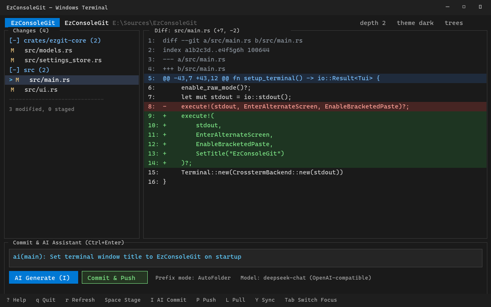

<div align="center">

# EzConsoleGit

### Fast, lightweight Git diff viewer & AI commit assistant for your terminal

[](https://www.rust-lang.org/)
[](https://ratatui.rs/)
[](LICENSE)
[](https://github.com/uponatime2019/EzConsoleGit)
[](https://github.com/uponatime2019/EzConsoleGit/releases/latest)

<br/>

**EzConsoleGit** is a keyboard-driven, high-performance **Terminal User Interface (TUI)** for Git diff inspection, smart folder-tree staging, and one-key AI-powered commit generation. Built in Rust with **[ratatui]** and **[crossterm]**.

---

### 🚀 [Download Portable Release (Windows, macOS & Linux)](https://github.com/uponatime2019/EzConsoleGit/releases/latest)

*Standalone zero-install binaries available for **Windows (x64 & ARM64)**, **macOS (Apple Silicon & Intel)**, and **Linux (x64 & ARM64)**. Extract anywhere and run immediately.*

---



</div>

---

## 🌊 Git Commits in the "Vibe Coding" Revolution

The way software is built has fundamentally changed. In the era of **Vibe Coding**—where developers partner with autonomous AI agents and LLMs to generate whole features, refactor subsystems, and iterate at the speed of thought—the primary bottleneck is no longer typing syntax.

**The new bottleneck is version control comprehension and commit velocity.**

When an AI assistant touches 30 files across 6 folders in 10 seconds:
- ❌ **Traditional commit habits collapse**: Reviewing hundreds of lines in a sluggish browser or heavy GUI takes longer than generating the code itself.
- ❌ **The "WIP" Trap**: Developers resort to generic commits like `"wip"`, `"fix"`, or giant monolithic commits that turn `git bisect` and team code reviews into a nightmare.
- ❌ **Context evaporates**: Without clean, granular commits, rolling back a hallucinated edge case means throwing away an hour of productive progress.

**EzConsoleGit was engineered specifically for the Vibe Coding workflow:**
- 🌳 **Multi-Depth Folder-Tree Grouping**: Rather than drowning in a flat list of 50 changed files, EzConsoleGit automatically aggregates changes by folder depth. You can review, stage, and commit logical subsystems independently with a single keystroke.
- 🧠 **Context-Aware Diff Compaction**: Giant diffs with boilerplates are compressed into token-efficient summaries, stripping noise so your AI model captures the true intent of the change.
- 🏷️ **Smart Path-Tag Prefixes**: Commits automatically receive semantic tags like `[crates/auth]` or `[src/ui]` based on where the most meaningful edits occurred.
- ⚡ **One-Touch Commit & Push (`I`)**: Generate a clean, conventional commit message and push it to remote without ever leaving your terminal or breaking your flow state.

*Vibe code at full throttle—while maintaining a clean, production-grade Git history.*

---

## ⚡ App Startup & Resource Efficiency: Pure Rust vs. The Heavyweights

Most modern Git clients have grown bloated with multi-process web runtimes, Chromium wrappers, and gigabyte-heavy frameworks. When you just want to inspect a diff or commit your code, waiting seconds for an application to launch breaks your flow.

**EzConsoleGit** is compiled to bare-metal native code with zero runtime dependencies. It launches **instantly in under 20 milliseconds**, consumes negligible memory, and leaves your CPU and RAM free for your compilers and local language models.

| Git Client | Technology / Engine | Binary Size | Cold Startup Time | Idle RAM Usage | Architecture Overhead |
| :--- | :--- | :--- | :--- | :--- | :--- |
| **EzConsoleGit** | **Native Rust (Ratatui / Crossterm)** | **~4 MB** | **< 20 ms** *(Instant)* | **~15 – 25 MB** | **Zero runtime dependencies, single portable binary** |
| **GitHub Desktop** | Electron / Chromium / Node.js | ~180 MB | ~2.5 – 4.0 s | ~250 – 450 MB | Multi-process Chromium, webview DOM rendering |
| **GitKraken** | Electron / Node.js | ~250 MB+ | ~3.0 – 5.5 s | ~350 – 600 MB | Heavy JavaScript bundle, cloud telemetry & login gate |
| **SourceTree** | C# / WPF / .NET Framework | ~150 MB | ~3.5 – 6.0 s | ~220 – 380 MB | Background indexing locks, sluggish tab switching |
| **VS Code (Source Control)** | Electron / Monaco Editor | ~350 MB+ | ~2.0 – 4.0 s | ~400 – 850 MB | Full editor overhead, extension host delays |
| **LazyGit** | Go (gocui) | ~20 MB | ~80 – 150 ms | ~40 – 75 MB | Terminal TUI, but lacks built-in AI commit intelligence |

### Why Native Rust Matters in the Terminal:
- 🚀 **Zero Cold Start**: Open a terminal, type `EzConsoleGit` (or alias `ecg`), and you're immediately looking at your repository status—no splash screens, loading spinners, or update checks.
- 💾 **Microscopic Footprint**: Keeps less than 25 MB of RAM in use, making it ideal for low-spec laptops, remote SSH jump hosts, dev containers, and resource-heavy local AI development.
- 📦 **Zero-Install Portability**: Single standalone executable. No WebView2 runtime, no .NET runtime, no Node.js runtime, and no installer required.

---

## 🎯 Key Capabilities

- 🤖 **AI-Powered Commit Messages** — Integrates with any OpenAI-compatible API (`/v1/chat/completions`), including DeepSeek, OpenAI, Groq, Ollama, and OpenRouter. Features automated diff compaction, folder-tag prefixes (`auto`, `custom`, `both`, `none`), and one-key AI commit & push (`I`).
- 🔍 **Syntax-Classified Diff Viewer** — Color-coded added, removed, hunk, and metadata lines with line-number gutter, smooth vertical and horizontal panning, and toggleable unified single-diff mode (`v`).
- 🌳 **Directory Depth Grouping** — Group changed files into expandable tree hierarchies (depth 1–6), with batch staging, unstaging, or AI committing per folder group.
- ⚡ **One-Click Git Operations** — Fast keyboard shortcuts for Push (`P`), Pull (`L`), Sync (`Y`), batch/single staging (`Space` / `s` / `u`), discard/reset (`d`), and quick ignore (`n`).
- 🛡️ **Conflict & Lock Healing** — Detects push rejections with automatic pull-and-retry, plus automatic recovery when encountering stale `.git/index.lock` files.
- 🖼️ **Image Diff Awareness** — Detects image modifications (`.png`, `.jpg`, `.gif`, `.webp`, `.svg`, etc.), reports before/after byte differences, and opens them in your native viewer with `e`.
- 📜 **Interactive Commit Log** — Paginated commit history browser (`H`) with instant inspection of per-commit file changes and unified diffs.
- 🎨 **Adaptive Themes** — Built-in Fluent Dark and Light color palettes (`t`), designed for high contrast and terminal clarity.

---

## ⌨️ Keyboard Shortcuts Reference

All shortcuts can also be referenced at any time in-app by pressing `?`.

### Global Navigation & Actions

| Key | Action |
| :--- | :--- |
| `?` | Toggle in-app help overlay |
| `q` / `Ctrl+C` | Quit application safely |
| `r` / `F5` / `Ctrl+R` | Refresh repository status |
| `o` | Open repository switcher (recent list / custom path) |
| `H` | View commit history |
| `S` | Open AI & Git configuration dialog |
| `P` | Git Push to remote |
| `L` | Git Pull from remote |
| `Y` | Git Sync (Pull then Push) |
| `I` / `Ctrl+I` | Instant AI commit & push for all changes |
| `Ctrl+Enter` | Commit & push current commit message |
| `A` | AI commit every folder tree, sequentially |
| `D` | Reset / discard all changes in working tree |
| `x` | Expand / collapse all folder groups |
| `v` | Toggle unified single diff view |
| `-` / `+` | Decrease / increase folder grouping depth (1–6) |
| `[` / `]` / `\` | Narrow / widen / reset sidebar width |
| `t` | Cycle theme (`dark` ↔ `light` ↔ `system`) |
| `Tab` / `Shift+Tab` | Cycle focus: **Changes** → **Diff** → **Commit** |
| `1` / `2` / `3` | Jump directly to Changes (`1`), Diff (`2`), or Commit (`3`) |
| `Ctrl+G` | Focus commit message input editor |
| `Esc` | Close dialog or exit commit inspection mode |

### Changes Panel

| Key | Action |
| :--- | :--- |
| `j` / `k` (or `↓` / `↑`) | Move selection up / down |
| `PgUp` / `PgDn` | Scroll by 10 rows |
| `g` / `G` | Jump to first / last item |
| `Enter` | Open diff for file, or expand / collapse folder group |
| `l` / `h` (or `→` / `←`) | Expand / collapse current folder group |
| `Space` / `s` / `u` | Stage / unstage selected file or entire folder group |
| `d` | Discard changes (revert modified or delete untracked) |
| `i` | Instant AI commit for the selected file only |
| `a` | AI commit the selected folder tree only |
| `c` | Commit & push selected file / folder group |
| `n` | Add selected untracked path to `.gitignore` |
| `e` / `E` | Open file in default editor / reveal in file manager |
| `y` | Copy file path to clipboard |

### Diff Panel

| Key | Action |
| :--- | :--- |
| `j` / `k`, `PgUp` / `PgDn` | Scroll vertically through diff hunks |
| `g` / `G` | Jump to top / bottom of diff |
| `h` / `l` | Pan horizontally (scroll wide lines) |
| `0` | Reset horizontal scroll offset to start |

### Dialogs & Overlays

| Dialog | Controls |
| :--- | :--- |
| **Settings (`S`)** | `Tab` / `↑` / `↓` navigate fields · `←` / `→` select prefix mode · `Enter` test connection / save · `F2` reveal API key · `Ctrl+S` save · `Esc` cancel |
| **Repositories (`o`)** | `j` / `k` select repository · `Enter` switch · `d` remove from recent · `i` enter path manually · `Esc` close |
| **Commit Log (`H`)** | `j` / `k` select commit · `h` / `l` or `PgUp` / `PgDn` page through history · `Enter` inspect commit diffs · `Esc` close |
| **Confirm / Prompt** | `Enter` / `y` confirm action · `Esc` / `n` cancel action |

---

## 🛠️ Architecture & Tech Stack

```
EzConsoleGit/
├── Cargo.toml                 # Workspace configuration & release binary definition
├── .cargo/config.toml         # Linker configuration
├── .github/workflows/         # Automated GitHub Actions release pipeline
│   └── release.yml
├── crates/
│   └── ezgit-core/            # Pure, GUI-free Git & AI core engine
│       ├── src/ai_service.rs      # OpenAI API client, diff compaction, prompt generation
│       ├── src/git_service.rs     # Git CLI orchestration, status parsing, diffs, push/pull
│       ├── src/models.rs          # Data structures for git status, commits, and settings
│       ├── src/settings_store.rs  # Multi-platform JSON settings loader & backward compatibility
│       └── src/platform_service.rs# Clipboard and desktop shell integration
└── src/
    ├── main.rs                # Entrypoint, terminal initialization, event loop
    ├── app.rs                 # Application state, keybindings, and modal flow
    ├── diff_lines.rs          # Unified diff parser and syntax classifier
    ├── grouping.rs            # Directory depth hierarchy calculation
    ├── jobs.rs                # Asynchronous worker thread channels
    ├── text_input.rs          # Inline multi-byte line editor
    ├── theme.rs               # Color palettes (Dark, Light, System)
    └── ui.rs                  # Ratatui rendering engine for all panels & dialogs
```

All Git and AI HTTP requests run on background worker threads via `tokio` and report progress asynchronously over channels, keeping terminal input responsive and smooth even during remote Git operations.

---

## 🚀 Building & Running from Source

### Prerequisites

- [Rust](https://rustup.rs/) (1.77 or later)
- Git CLI available on your system `PATH`

### Run in Development

```bash
# Clone the repository
git clone https://github.com/uponatime2019/EzConsoleGit.git
cd EzConsoleGit

# Run directly
cargo run --release
```

### Build Portable Binary

```bash
cargo build --release
```

The compiled standalone executable will be located at:
- **Windows**: `target/release/EzConsoleGit.exe`
- **Linux / macOS**: `target/release/EzConsoleGit`

### Run Unit Tests

```bash
cargo test --workspace
```

---

## ⚙️ Configuration & Settings

Settings are automatically saved in your standard user directory:
- **Windows**: `%LOCALAPPDATA%\EzConsoleGit\settings\`
- **Linux**: `~/.config/EzConsoleGit/settings/`
- **macOS**: `~/Library/Application Support/EzConsoleGit/settings/`

> **Seamless Migration**: EzConsoleGit automatically detects and reads existing settings from previous `EzGit` and `EleEzGit` installations, so your AI API keys and preferences work out of the box!

---

## 🗺️ Roadmap

- [x] Fast TUI interface powered by Ratatui & Crossterm
- [x] Intelligent AI commit message generator with folder-tag prefixing
- [x] Multi-depth directory tree staging and diff viewer
- [x] Git conflict and index lock self-healing
- [x] Multi-platform compatibility (Windows, Linux, macOS)
- [ ] Side-by-side (split) diff view mode in terminal
- [ ] Interactive Git rebase & commit squashing assistant
- [ ] Customizable syntax highlighting themes via configuration file
- [ ] Stash management panel (list, pop, apply, drop)
- [ ] Git submodule status and batch update support

---

## 🤝 Contributing

Contributions are warmly welcomed! Whether you want to fix a bug, suggest an enhancement, or improve documentation:

1. **Fork** the repository
2. **Create a branch**: `git checkout -b feature/my-new-feature`
3. **Commit your changes**: `git commit -m "Add new feature"`
4. **Push to branch**: `git push origin feature/my-new-feature`
5. **Open a Pull Request**

Please check our [Contributing Guidelines](CONTRIBUTING.md) for more details.

---

## 📄 License

This project is licensed under the [MIT License](LICENSE) &copy; 2026 uponatime2019.

[ratatui]: https://ratatui.rs
[crossterm]: https://github.com/crossterm-rs/crossterm
